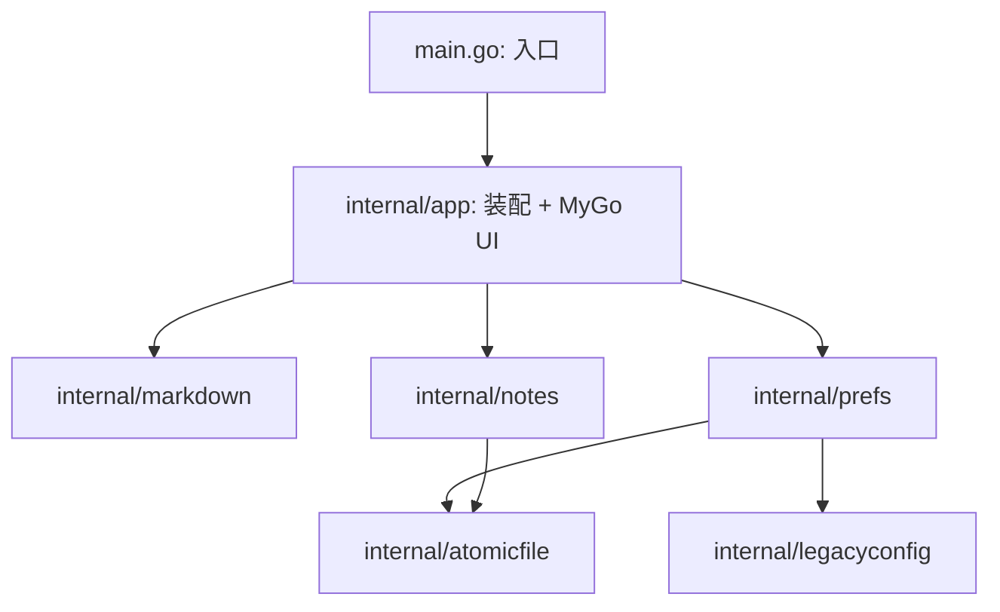

# Tot MD 工程与架构标准

本文是本仓库的工程约束与目标架构。任何人或 agent 改代码前先读 [AGENTS.md](../AGENTS.md)，
动结构前读本文，动具体模块前读 [architecture.md](architecture.md)。

- 「必须 / 禁止」是硬规则，违反即不合格，评审直接打回。
- 「应 / 建议」是默认做法，偏离时在提交说明里写明理由。
- 本文描述**目标状态**。当前代码尚未全部达标，按第 7 节的阶段逐步迁移；
  未迁移的部分保持现状即可，不要在无关提交里顺手搬动。

## 1. 参考依据

标准不是凭空定的。每一条规则都能追溯到下列来源之一，下表说明从中借鉴了什么。

| 来源 | 借鉴内容 |
|---|---|
| [Go 官方：Organizing a Go module](https://go.dev/doc/modules/layout) | 可执行程序入口留在模块根目录；不对外暴露的包放 `internal/`，由编译器保证外部无法 import。**不**引入 `pkg/`，也不照搬 golang-standards/project-layout（官方明确它不是标准）。 |
| [Go Code Review Comments](https://go.dev/wiki/CodeReviewComments) | 包名短小、小写、名词；禁止 `util`/`common`/`helpers` 这类无语义包名；避免包名与标识符重复（`markdown.Parse` 而不是 `markdown.ParseMarkdown`）；接口由使用方定义。 |
| [Google Go Style Guide](https://google.github.io/styleguide/go/) | 清晰优先于简洁；错误用 `%w` 包装并带上下文；godoc 注释以标识符开头；测试失败信息写清 got/want。 |
| [Uber Go Style Guide](https://github.com/uber-go/guide/blob/master/style.md) | mutex 与它保护的字段放在同一结构体并紧挨声明；不嵌入 mutex；不用可变全局状态；结构体零值可用或提供构造函数。 |
| MyGo 官方示例与仓库约定（`go list -m -f '{{.Dir}}' github.com/egoist/mygo`） | `examples/todo/store.go` 把存储与视图分开；`examples/mayoi`、`examples/farm` 按领域（world/art/sound）分文件，根目录 `package main`。MyGo 自身用 `internal/` 加 `internal/fake` 做单测。`go tool mygo vet` 内部执行 `go vet ./...` 并分析 `./...` 的全部包，因此子包同样受 UI 生命周期检查。 |
| [micro 编辑器](https://github.com/zyedidia/micro) | `internal/buffer`（文本模型）与 `internal/display`（渲染）分离，文本模型不依赖渲染层。对应本项目：Markdown 解析与格式变换不依赖 MyGo UI，实时预览编辑留在 UI 层。 |
| [lazygit](https://github.com/jesseduffield/lazygit) | `pkg/gui` 单向依赖 `pkg/commands`、`pkg/config`，领域层从不反向引用 GUI。对应本项目：`internal/app` 依赖纯逻辑包，纯逻辑包不知道 UI 的存在。 |
| [.agents/skills/mygo-maintenance/SKILL.md](../.agents/skills/mygo-maintenance/SKILL.md) | MyGo 的生命周期、身份、线程与测试规则（第 4 节引用）。 |

## 2. 目标布局

采用**薄入口 + 领域包**布局：根目录只留入口 `main.go`（调 `internal/app.Run()`）；
MyGo UI 与应用装配整体作为 `internal/app` 一个包；纯逻辑和持久化下沉到 `internal/` 其余包。

理由：UI 代码大量依赖 `*app` 与 `*ui.Context`，按文件逐个拆包只会制造大量导出和循环依赖；
但整层平移成一个包不需要导出任何内部符号，边界依旧可被编译器和 `arch-check` 机械保证；
解析、格式变换、持久化是纯逻辑，独立成包后可脱离 MyGo 做快速单测。

```text
tot-md-mygo/
├── AGENTS.md                 # agent 硬规则入口
├── Makefile                  # 本地/CI 统一检查入口
├── go.mod / go.sum
├── mygo.json                 # MyGo 打包配置
├── main.go                   # 唯一入口：调 internal/app.Run()
├── internal/
│   ├── app/                  # MyGo UI 与应用装配：生命周期、菜单、托盘、视图、实时预览、
│   │                         # 标签、表格、设置、全局热键；文件按领域前缀命名（live_*/view_*…）
│   ├── markdown/             # 解析、行内 span、块切分、格式变换、表格纯函数
│   ├── notes/                # 笔记数据模型、版本迁移、保存、备份、损坏隔离、写回
│   ├── prefs/                # 偏好模型、校验、解码、迁移、保存
│   ├── legacyconfig/         # 旧 config.toml/config.json 严格解码（仅迁移用）
│   └── atomicfile/           # tmp+rename 原子写
├── resources/                # 图标等打包资源
├── docs/                     # 文档；docs/demo 为设计原型，不参与构建
├── .agents/skills/           # 项目内 agent skill
├── build/  .mygo/            # 生成目录，已 gitignore，禁止提交
└── .github/workflows/ci.yml
```

### 2.1 现有文件 → 目标位置

> 本表是当初单包迁移时的历史映射。表中“根目录”自 UI 层整体下沉后（`refactor: UI 层平移 internal/app`）均指 `internal/app`。

| 现有文件 | 目标位置 | 说明 |
|---|---|---|
| `markdown.go` | `internal/markdown` | 除 `editorRanges`、`sortRanges` 外全部迁入；这两个依赖 `ui.TextRange`/`ui.Theme`，留在根目录 view 层（如 `view_highlight.go`）。 |
| `formats.go` | `internal/markdown` | 整体迁入（已无 MyGo 依赖）。 |
| `table.go` | 纯函数 → `internal/markdown`；`(a *app)` 方法 → 根目录 `table_edit.go` | 纯函数：`pipeCells`、`tableStart`、`emptyTableRow`、`tableCellPositions` 及 `tableCell`/`markdownTable` 类型。 |
| `tableactions.go` | 纯函数 → `internal/markdown`；`(a *app)` 方法 → 根目录 `table_actions.go` | 纯函数：`tableCellIndex`、`tableDivider`、`tableAllAligned`、`tableResizeDropsContent`、`resizedTable`。`tableTools` 是 UI 状态，留根目录。 |
| `config.go` | `internal/legacyconfig` | 整体迁入。 |
| `prefs.go` | 模型/校验/解码/迁移/写盘 → `internal/prefs`；`(a *app)` 运行时应用 → 根目录 `prefs_runtime.go` | 迁入：`preferences` 及子结构、`defaultPreferences`、`validate`、`decodePreferences`、`rejectJSONNull`、`migrationResult`、`migrateLegacyConfig`、`preferencesFromNotes`、`preferencesFromFileConfig`、`prefsIssue*`、快照与修订号逻辑；迁移后导出名为 `MigrationResult`、`MigrateLegacy`、`FromNotes`、`MergeFileConfig`（根目录 `prefs_bridge.go` 留类型别名）。留根目录：`updatePreferences`、`applyPreferencesToRuntime` 等触达窗口/菜单/热键的方法。 |
| `prefs.go` 的 `atomicWriteJSON`、`state.go` 的 `writeSnapshotLocked` 中的 tmp+rename | `internal/atomicfile` | 两处重复实现合并为一个（`atomicfile.WriteJSON`/`WriteBytes`），`notes` 与 `prefs` 共用。 |
| `state.go` 持久化部分 | `internal/notes` | `savedFile`/`savedTab`/`settings` 磁盘模型、`migrateSavedFile`、`normalizeSavedTabs`（迁后名 `normalizeTabs`）、`tabsFromDots`、`versionError`、`hasHideOnEscapeKey`、`load`/保存/防抖/备份/修剪/隔离/写回，以及 `persistMu` 和它保护的字段，以 `notes.Store` 暴露（锁并入 Store 内部 `mu`）。 |
| `state.go` 其余部分 | 根目录 | `dotTheme`/`dotColor` 等主题色 → `themes*.go`；`showWindow`/`toggleWindow`/`applyAlwaysOnTop` → `window.go`；字数统计 → `status*.go` 或 `internal/markdown`（纯函数）。 |
| `main.go`、`commands.go`、`keymap.go`、`formatcmd.go`、`liveedit.go`、`liveprojection.go`、`livewidgets.go`、`tabs.go`、`tabstrip.go`、`tabletoolbar.go`、`settings*.go`、`themes.go`、`icons.go`、`trayicon.go`、`view.go` | 根目录 | 只在第 7 节阶段 5 按命名规范重命名/拆分。 |

## 3. 依赖规则



**必须**：

1. 纯逻辑包（`markdown`/`notes`/`prefs`/`legacyconfig`/`atomicfile`）**禁止** import `github.com/egoist/mygo`
   及其任何子包（含 `ui`）。需要颜色、文本区间等 UI 类型时，在 `internal` 包里定义领域类型
   （如 `markdown.SpanKind`），由 `internal/app` 转换为 `ui.TextRange`。`internal/app` 是
   唯一允许依赖 MyGo 的 internal 包。
2. 纯逻辑包禁止反向依赖 `internal/app`；`internal` 包之间只允许下图中的边：

   | 包 | 允许依赖的 internal 包 |
   |---|---|
   | `app` | `markdown`、`notes`、`prefs`、`legacyconfig`、`atomicfile`（唯一可依赖 MyGo） |
   | `markdown` | 无 |
   | `atomicfile` | 无 |
   | `legacyconfig` | 无 |
   | `notes` | `atomicfile` |
   | `prefs` | `legacyconfig`、`atomicfile` |

3. 新增 `internal` 包或新增依赖边，必须在同一次提交里更新本节的图与表，以及 `arch-check`。
4. 第三方依赖新增需在提交说明里写明理由；当前只允许 `github.com/egoist/mygo` 与
   `github.com/pelletier/go-toml/v2`（后者只能被 `internal/legacyconfig` 使用）。

### 3.1 机械校验 `make arch-check`

由阶段 1 落地，加入 `make check` 与 CI。参考实现（Makefile 必须用 tab 缩进）：

```make
# 纯逻辑包 → 允许依赖的 internal 包（空格分隔，空表示无）
ARCH_RULES := \
	markdown: \
	atomicfile: \
	legacyconfig: \
	notes:atomicfile \
	prefs:legacyconfig,atomicfile

arch-check:
	@echo "==> arch-check：纯逻辑包不得依赖 MyGo 与 internal/app，且只允许约定的 internal 依赖"
	@fail=0; for rule in $(ARCH_RULES); do \
		pkg=$${rule%%:*}; allow=$${rule#*:}; dir=./internal/$$pkg; \
		[ -d "$$dir" ] || continue; \
		if go list -deps "$$dir" | grep -q '^github.com/egoist/mygo'; then \
			echo "  internal/$$pkg 依赖了 MyGo"; fail=1; fi; \
		for dep in $$(go list -f '{{join .Imports "\n"}}' "$$dir" | grep '^tot-md-mygo/internal/' | sed 's|tot-md-mygo/internal/||'); do \
			case ",$$allow," in *",$$dep,"*) ;; *) echo "  internal/$$pkg 不允许依赖 internal/$$dep"; fail=1;; esac; \
		done; \
	done; for dep in $$(go list -f '{{join .Imports "\n"}}' ./internal/app | grep '^tot-md-mygo/internal/' | sed 's|tot-md-mygo/internal/||'); do \
		case " markdown atomicfile legacyconfig notes prefs " in *" $$dep "*) ;; *) echo "  internal/app 依赖了非约定包 internal/$$dep"; fail=1;; esac; \
	done; [ $$fail -eq 0 ] && echo "    arch-check 通过"
```

目录不存在时跳过，因此可以先于各包落地。

## 4. 状态与并发规则

### 4.1 `app` 是装配根

- `app`（`internal/app` 包内）**应**只由领域子结构体和 Store 组合而成，不再平铺零散字段。目标形态：

  ```go
  type app struct {
  	tabs   tabsState         // 标签数据、当前下标、nextTabID
  	tabBar tabStripState     // 标签栏动画、重命名
  	editor liveEditorState   // 实时预览：md*/sel*/keyHint/autoTable*/liveUndo/缓存
  	src    sourceEditorState // 源码模式选区与撤销快照
  	format formatState       // 待输入格式意图、链接浮层
  	find   findState         // 查找条
  	desk   desktopRefs       // *mygo.Window、*mygo.Menu、*mygo.MenuItem、托盘、热键
  	settingsWin settingsWindowState // 设置窗口、当前页与草稿

  	notes *notes.Store // 笔记持久化（自带锁）
  	prefs *prefs.Store // 偏好持久化（自带锁）

  	cfg   settings // 运行时视图缓存
  	ready bool
  	now   func() time.Time
  }
  ```

- 新增状态**必须**放进对应子结构体；找不到归属时先新建子结构体，**禁止**往 `app` 顶层继续加字段。
- 子结构体的方法**应**定义在子结构体上（如 `func (e *liveEditorState) ...`），
  只有需要跨领域协作时才写成 `(a *app)` 方法。

### 4.2 线程边界

- 只在主线程读写的状态**禁止**加锁，也**禁止**被 goroutine、`time.AfterFunc` 回调读取。
- 后台会读写的状态**必须**封装在带自身 mutex 的 Store 类型里（`notes.Store`、`prefs.Store`），
  mutex 不导出、不嵌入，紧挨它保护的字段声明。`app` 不直接持有任何 `sync.Mutex`。
- 后台只接触主线程拍下的**不可变快照**；写完盘回主线程刷新**只**用 `Window.Update`。
- 修订号、`stopped` 标志等防并发覆盖的机制属于 Store 的内部实现，迁移时语义必须保持不变。

### 4.3 MyGo 规则（摘自 mygo-maintenance skill，必须遵守）

- `ui.Element` 和自定义 parts **禁止**存入任何跨帧状态；持久身份用 `ui.Handle` + `.Bind`。
- `*ui.Context` **禁止**存入状态或传给后台；需要持久回调时捕获 `c.Services()`。
- 有状态控件在构建前用 `c.Key(key)` 给出稳定且唯一的身份。
- 视图一帧可能构建多次，副作用只能放在 `OnClick`/`OnShortcut` 等动作或显式保护的任务里。
- 慢 I/O 与重计算不得在 UI 线程执行。

## 5. 编码规范

### 5.1 文件与命名

- 非测试文件软上限 **600 行**，超过 **800 行必须拆分**。一个文件只负责一个领域。
- `internal/app` 文件按领域前缀命名：`live_*`、`tab_*`、`table_*`、`settings_*`、`menu_*`、`view_*`。
  新文件立即遵守；既有文件在阶段 5 统一重命名，之前不单独改名。
- 测试文件与被测文件同前缀（`live_edit.go` ↔ `live_edit_test.go`）。
- `internal` 包对外只导出调用方真正需要的标识符；导出名不重复包名
  （`markdown.ParseBlocks`、`notes.Store`、`prefs.Default()`）。
- 禁止 `util`、`common`、`helpers`、`misc` 之类的包名和文件名。

### 5.2 注释

- 注释用中文，只写代码本身表达不出的约束（线程归属、不变量、格式兼容原因）；
  不写「下一行做什么」，不写「为什么这样改是对的」。
- 导出标识符必须有 godoc，以标识符名开头。
- 现有英文注释在触及该处时改为中文，不单独发提交。

### 5.3 错误与日志

- 错误用 `fmt.Errorf("动作: %w", err)` 包装并带上下文；判断用 `errors.Is`/`errors.As`。
- 日志统一 `log/slog`；禁止 `fmt.Println`/`log.Printf` 调试输出残留。
- 持久化失败**必须**如实上报（返回错误、状态栏/设置页提示），**禁止**吞掉或装作成功。
- `panic` 只用于程序员错误（不变量被破坏），不用于可预期的 I/O 或输入错误。

### 5.4 数据契约

- 笔记数据文件 `tot-md.json`、`preferences.json` 的格式与迁移语义是对用户的契约。
  结构迁移类提交**禁止**改变它们；需要改格式时单独发 `feat`/`fix` 提交，
  递增版本号、补迁移与回归测试，并同步 [architecture.md](architecture.md) 与 [configuration.md](configuration.md)。

## 6. 测试与工程化

### 6.1 测试分层

| 层 | 位置 | 要求 |
|---|---|---|
| 纯逻辑单测 | `internal/<pkg>/*_test.go` | 表驱动；不依赖 MyGo；覆盖 CJK/emoji/光标映射等边界。 |
| 持久化回归 | `internal/notes`、`internal/prefs` | 一律 `t.TempDir()` + 注入时钟；**绝不**写真实用户目录；覆盖损坏、超前版本、写失败、修订号防回写。 |
| UI 与集成 | `internal/app/*_test.go` | `ui.NewTester` 构建视图、模拟按键；覆盖元素消失再出现、焦点、输入法、快捷键；用 `newTestApp(t)`。 |
| 性能 | `bench_test.go` 及各包 `Benchmark*` | 性能敏感路径（块切分、投影、渲染缓存）保留基准，重构前后对比。 |

- 修 bug **必须**先补能复现的失败测试。
- 迁移代码时测试随代码一起迁移，断言内容不得放宽。

### 6.2 检查命令

| 命令 | 内容 |
|---|---|
| `make fmt-check` | gofmt（排除 `build/`、`.mygo/`） |
| `make vet` | `go vet ./...` + `go tool mygo vet .` |
| `make test` | `CGO_ENABLED=0 go test ./... -count=1` |
| `make race` | `go test -race ./... -count=1` |
| `make arch-check` | 第 3.1 节依赖校验（阶段 1 起） |
| `make check` | 以上全部；**每次提交前必须全绿** |
| `make build` | `go tool mygo build` 打包 `.app`/`.dmg` 到 `build/` |

CI（`.github/workflows/ci.yml`，`macos-latest`）执行 `go mod verify`、`go build ./...` 与上述检查，
不得通过跳过测试、加 `-run` 过滤或放宽检查让 CI 变绿。

### 6.3 提交

- 中文 commitlint：`git commit -m "<type>: <描述>"`，type 取 `feat`/`fix`/`refactor`/`style`/`docs`/`chore`/`test`/`perf`。
- 一次提交只做一件事。纯结构迁移用 `refactor:`，**禁止**夹带行为变更、格式变更或 lint 清理。
- 未经用户允许不做 lint 类修改。
- 文件迁移或职责变化时，**必须**在同一次提交里同步更新 [architecture.md](architecture.md) 的模块表。
- 禁止提交 `build/`、`.mygo/`、根目录二进制 `tot-md-mygo`、`*.syso`。

## 7. 分阶段迁移路线

每个阶段交给一个 agent，可拆成多次提交，但阶段结束时必须满足验收标准。
阶段之间严格按顺序，后一阶段开始前前一阶段的提交必须已落地。

**所有阶段的通用约束**：不改变用户可见行为；不改 `tot-md.json` 与 `preferences.json` 格式和迁移语义；
测试只能迁移、不能删除或放宽；每次提交 `make check` 全绿。

### 阶段 0：提交现有工作

- 把当前未提交与未跟踪的改动按功能拆成多次中文提交（如：动态标签与标签栏、偏好与设置窗口、
  命令注册表与快捷键、格式命令、表格编辑、实时预览重写、主题、工程化与 CI、文档）。
- 拆分时保证每个提交都能编译通过；做不到时合并相邻功能，不要伪造中间状态。
- 验收：`git status` 干净（生成物除外）；`make check` 全绿。

### 阶段 1：文档对齐与架构校验

- 修正 [architecture.md](architecture.md) 与代码不一致处：
  - 「版本迁移」一节仍写 `currentDataVersion = 1`，代码已是 `2`（`state.go`）；
  - 「数据文件格式」示例 JSON 仍是 7 个 `dots` 的旧格式，应改为 `tabs`；
  - 模块职责表缺 `tabs.go`、`tabstrip.go`、`table.go`、`tableactions.go`、`tabletoolbar.go`、
    `livewidgets.go`、`settings_tabs.go`；
  - 「`markdown.go` 是无 UI 依赖的纯函数」与事实不符（`editorRanges` 依赖 `ui`），改为如实描述，阶段 2 后再改回。
- 按第 3.1 节新增 `make arch-check`，加入 `make check` 与 CI。
- 验收：文档中提到的文件名、函数名、常量值均能在代码中找到；`make check` 含 arch-check 且全绿。

### 阶段 2：抽出 `internal/markdown`

- 按第 2.1 节迁入 `markdown.go`、`formats.go` 与 `table.go`/`tableactions.go` 的纯函数，按需导出。
- `editorRanges`/`sortRanges` 移到根目录 view 层；`internal/markdown` 提供领域区间类型，由 view 层转换为 `ui.TextRange`。
- 纯逻辑测试（`formats_test.go`、`markdown_edge_test.go`、`table_test.go` 中不依赖 `app` 的用例）迁入该包。
- 验收：`internal/markdown` 不依赖 MyGo（arch-check 通过）；迁移前后测试用例数量不减少；`make check` 全绿。

### 阶段 3：抽出 `internal/atomicfile`、`internal/legacyconfig`、`internal/prefs`

- 先抽 `atomicfile`，合并 `atomicWriteJSON` 与 `writeSnapshotLocked` 里的 tmp+rename；保持「rename 失败如实上报」。
- `config.go` 整体迁入 `legacyconfig`；`go-toml` 只在此包出现。
- `prefs` 提供 `Store`（锁、修订号、防抖保存、停止与最终保存）；根目录 `prefs_runtime.go` 保留
  `updatePreferences`、`applyPreferencesToRuntime` 等触达原生 API 的逻辑。
- `prefs_test.go`、`config_test.go` 的纯逻辑用例迁入对应包；根目录只保留运行时集成测试。
- 验收：arch-check 通过；`make race` 通过；迁移/损坏/超前版本/写失败/修订号用例全部保留。

### 阶段 4：抽出 `internal/notes`

- 按第 2.1 节把笔记持久化迁成 `notes.Store`，`persistMu` 及其保护的字段（`pending`、`stopped`、
  `saveBlocked`、`lastBackup`、`lastSaveErr`、`saveTimer`）进入 Store；`app` 只持有 `*notes.Store`。
- 路径与时钟注入（`paths`、`now`）作为 Store 构造参数，`newTestApp(t)` 相应调整。
- `persistence_test.go` 中的持久化用例迁入 `internal/notes`。
- 验收：`app` 不再含 `sync.Mutex` 字段（`prefs` 已在阶段 3 移出）；全部持久化回归通过；`make race` 通过。

### 阶段 5：拆分 `app` 与大文件

- 按第 4.1 节把 `app` 剩余平铺字段收进子结构体，方法尽量下沉到子结构体。
- 拆分超限文件（当前 `view.go`、`liveedit.go` 及 `state.go` 剩余部分），并按第 5.1 节统一文件前缀重命名。
- 验收：没有超过 800 行的非测试文件；`app` 顶层只有子结构体、Store 与少量装配字段；
  `go tool mygo vet .` 无告警；`make check` 全绿；[architecture.md](architecture.md) 模块表与最终文件一一对应。

## 8. 评审清单

提交前自查，评审逐条核对：

- [ ] `make check` 全绿（含 arch-check，阶段 1 起）。
- [ ] 一次提交只做一件事，提交信息符合中文 commitlint。
- [ ] 结构迁移没有夹带行为、格式或 lint 变更。
- [ ] `internal/*` 没有 import MyGo，依赖边符合第 3 节。
- [ ] 没有往 `app` 顶层新增字段；新状态归属到子结构体或 Store。
- [ ] 没有存储 `ui.Element`/`*ui.Context`；后台只碰快照，回主线程只用 `Window.Update`。
- [ ] 新增或迁移的逻辑有测试；修 bug 有先失败后通过的回归测试。
- [ ] 文件迁移/职责变化已同步 [architecture.md](architecture.md)。
- [ ] 没有提交 `build/`、`.mygo/`、二进制等生成物。
